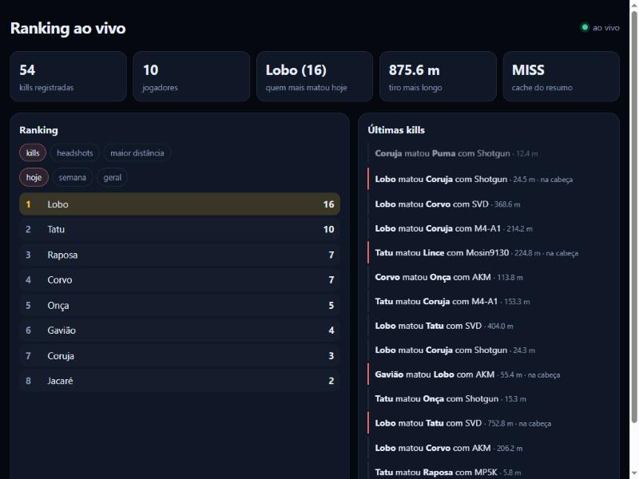

# realtime-leaderboard-redis

Ranking de jogo em tempo real com Redis: kills, headshots e tiro mais longo, por dia, por semana e geral, com uma página que atualiza sozinha a cada kill.



É o tipo de coisa que dá pra fazer em SQL, mas fica caro: um `ORDER BY kills DESC LIMIT 10` em cima de milhões de eventos a cada kill nova. No Redis o ranking já fica guardado ordenado (sorted set), então "top 10" e "qual a minha posição" são operações O(log n) e respondem na hora.

## Como os dados ficam no Redis

| Chave | Tipo | Pra quê |
|---|---|---|
| `lb:kills:all`, `lb:kills:d:2026-11-13`, `lb:kills:w:2026-W46` | sorted set | ranking geral, do dia e da semana (o mesmo pra `headshots` e `longest`) |
| `player:{id}` | hash | nome, kills, mortes, último evento |
| `lb:players` | set | quantos jogadores diferentes já apareceram |
| `cache:summary` | string (JSON) | resumo do servidor em cache por 30 s |
| `ratelimit:{chave}` | sorted set | janela deslizante do limite de requisições |
| `lb:updates` | canal pub/sub | avisa a página ao vivo de cada kill |

Os rankings do dia e da semana expiram sozinhos (8 e 35 dias). O prazo é definido com `EXPIRE ... NX` quando o ranking é criado, pra não ficar sendo renovado a cada kill e nunca expirar.

## Decisões

**Uma kill, um script Lua.** Cada kill mexe em até 9 rankings, 2 perfis, um contador, o cache e o canal. Se fosse um comando de cada vez, outra requisição podia ler o ranking no meio da atualização. O Redis roda o script inteiro sem intercalar nada, então ou tudo aconteceu ou nada aconteceu. Tem teste disparando 200 kills ao mesmo tempo e conferindo que nenhuma se perdeu.

**Tiro mais longo com `ZADD GT`.** Guarda só o recorde: se a distância nova for menor, o Redis ignora. Sem ler antes pra comparar (o que daria condição de corrida).

**Cache-aside com invalidação.** O resumo é calculado e guardado por 30 s, mas o script da kill apaga o cache. Então a leitura é rápida e nunca mostra número velho. O header `X-Cache: HIT/MISS` mostra o que aconteceu.

**Rate limit com janela deslizante, também em Lua.** Cada requisição vira um item com o horário num sorted set; o script apaga os que saíram da janela e conta o resto. Usa o relógio do próprio Redis (`TIME`), então várias instâncias da API dividem o mesmo limite sem depender do relógio de cada máquina. Quando estoura, volta 429 com `Retry-After`.

**Tempo real com pub/sub + Server-Sent Events.** O script publica a kill num canal; o endpoint `/stream` assina o canal e repassa pro navegador por SSE. SSE em vez de WebSocket porque a comunicação é só do servidor pro navegador, e o `EventSource` reconecta sozinho.

**Pool que espera em vez de falhar.** O teste das 200 kills simultâneas quebrou com `Too many connections`: o pool padrão do redis-py 8 dá erro quando acaba conexão. Troquei por `BlockingConnectionPool`, que espera uma conexão liberar. Em produção um pico de tráfego teria o mesmo problema.

Limitações que eu sei: empate no ranking é desempatado pelo id em ordem alfabética (dá pra usar o horário como fração do score se precisar); e o script usa chaves que, num Redis Cluster, cairiam em slots diferentes, aí teria que usar hash tags (`{lb}`) nos nomes.

## API

| Rota | |
|---|---|
| `POST /events/kill` | registra uma kill (header `X-Api-Key`, com rate limit) |
| `GET /boards/{kills\|headshots\|longest}?period=all\|day\|week&limit=10` | ranking |
| `GET /players/{id}` | perfil e posição em cada ranking |
| `GET /players/{id}/around?span=2` | quem está logo acima e logo abaixo |
| `GET /summary` | resumo do servidor (com cache) |
| `GET /stream` | eventos ao vivo (SSE) |
| `GET /` | a página ao vivo |

Documentação automática em `/docs`.

## Rodando

Precisa de Python 3.11+ e Redis 7+.

```
python -m venv .venv
.venv\Scripts\activate        (no Linux: source .venv/bin/activate)
pip install -e ".[dev]"
uvicorn leaderboard.api:app
```

Abre http://127.0.0.1:8000/ e, em outro terminal, gera kills:

```
python scripts/simulate.py --rate 3 --seconds 60
```

Configuração por variável de ambiente: `LB_REDIS_URL` (padrão `redis://127.0.0.1:6379/0`), `LB_API_KEY`, `LB_RATE_LIMIT` e `LB_RATE_WINDOW_MS`.

## Testes

```
pytest
```

19 testes contra um Redis de verdade, no banco 15 (apagado antes de cada teste). Os principais:

- 200 kills ao mesmo tempo e nenhuma se perde;
- 50 requisições simultâneas com limite 10, exatamente 10 passam;
- a janela do rate limit desliza (depois que o tempo passa, libera de novo);
- ranking do dia e da semana expiram, o geral não, e kill nova não renova o prazo;
- kill nova invalida o cache do resumo;
- a kill chega no canal de pub/sub.

No GitHub Actions rodam com um container `redis:7.4`.
